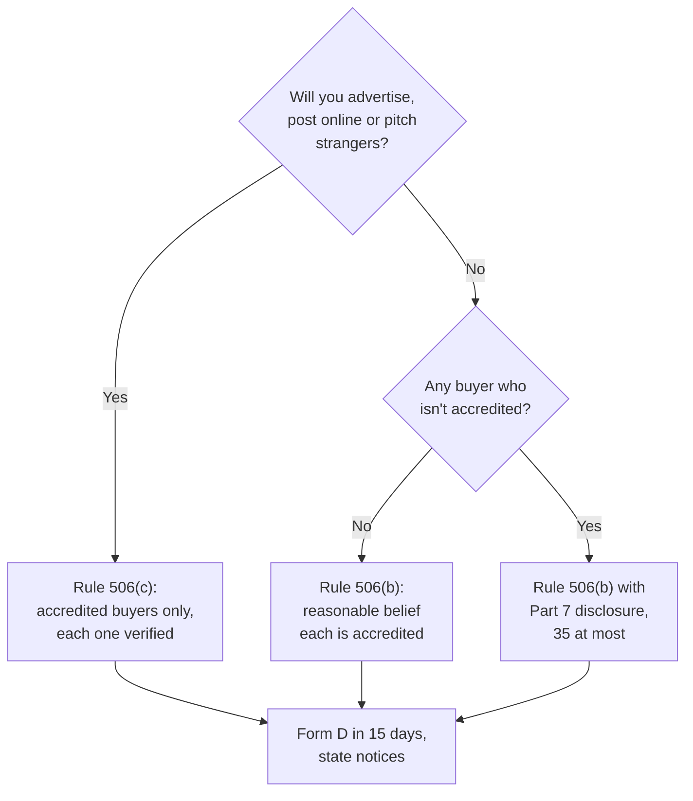

# Offering Record

> Legallas is an AI agent for legal work, not a lawyer or law firm. Using it creates no attorney-client relationship. AI can be wrong. Have your own lawyer review before you sign, file or rely on anything.
>
> No lawyer has reviewed this record.

## Before you use this

Every sale of a SAFE, note, stock or units is a sale of a security, and it needs an exemption from registration. The company has to prove the exemption later, so it keeps this record from the first pitch.

| | |
|---|---|
| **Start** | Before the first pitch to anyone about investing |
| **Keep it** | With the minute book. Counsel sees it; investors don't need it |
| **Deadline** | Form D within 15 calendar days after the first sale ([230.503(a)(1)][e503]). The first sale is when the first investor is irrevocably contractually committed, which can be the day a SAFE is signed ([Form D instructions][formd]) |
| **With it** | [Bad actor questionnaire](bad-actor-questionnaire.md) for each covered person; [investor certification](../investors/angels/accredited-investor.md) for each buyer; [Form D steps](../investors/funds/form-d-and-colorado-notice.md) |

Rule 506 isn't the only route: section 4(a)(2) alone, Regulation CF, Regulation A, Rule 504 and Colorado's crowdfunding and limited offering exemptions each have their own steps. The [document map](../../docs/design/document-set-and-law.md#path-2-startup-raises) compares them. This record is written for Rule 506, which most founder rounds use.

## The record

<!-- TEMPLATE START -->

**OFFERING RECORD: {{COMPANY_NAME}}, {{OFFERING_NAME}}**

**Part 1. The exemption.** The Company is offering {{INSTRUMENT}}, up to {{OFFERING_AMOUNT}}, relying on:

[OPTION A: Rule 506(b). No general solicitation.]
Rule 506(b) of Regulation D. No one will offer these securities by general solicitation or general advertising. Buyers are accredited investors, or at most 35 others in any 90 days who meet Part 7.
[END OPTION A]

[OPTION B: Rule 506(c). Advertising allowed.]
Rule 506(c) of Regulation D. The Company may advertise. Every buyer must be an accredited investor, and the Company takes reasonable steps to verify each one before sale (Part 6).
[END OPTION B]

Decided by {{DECIDED_BY}} on {{DECISION_DATE}}, because {{DECISION_REASONS}}.

**Part 2. What may be said.** Under Option A, every person pitched is one the Company, or someone acting for it, already knows well enough to judge their finances and experience, or who comes through Part 4's events or a registered broker-dealer. No posts, ads, press or open invitations about this offering. Under Option B, public statements are allowed, but they must be true and complete in what they say.

**Part 3. Contact log.** One row per person told about the offering.

| Date | Person or firm | How the Company knows them | How contacted | What they received | Accredited? | Result |
|---|---|---|---|---|---|---|
| | | | | | | |

**Part 4. Events.** One row per demo day, pitch event or online session where the offering came up.

| Date | Event and sponsor | More than one issuer took part? | Sponsor is a college, university or other institution of higher education, a government body, a nonprofit, an angel group, an incubator or an accelerator? | Event ads named no specific offering? | Sponsor gave no advice, took no part in negotiations, charged attendees only reasonable administrative fees, and was paid nothing tied to introductions or investments or that would need broker or adviser registration? | Company said only: that it is or plans to be raising, the type and amount, use of proceeds and amount unsubscribed? | Online attendance limited to members, people the sponsor believes accredited, or invitees picked on stated experience? |
|---|---|---|---|---|---|---|---|
| | | | | | | | |

**Part 5. Anyone paid to help.** One row per person or firm paid, or to be paid, for finding or talking to investors. Nobody is paid on what they raise unless registered.

| Name | Registered broker-dealer? CRD number and date checked on FINRA BrokerCheck | Licensed in each buyer's state? | Bad actor questionnaire signed? | Pay and basis | On Form D Item 12? |
|---|---|---|---|---|---|
| | | | | | |

**Part 6. Buyers.** One row per buyer, before the sale closes.

Under 506(c), each verification method looks back its own distance ([230.506(c)(2)(ii)][e506]). The methods are "non-exclusive and non-mandatory".

| Method | The rule's words on timing |
|---|---|
| Income, (A) | IRS forms "for the two most recent years" |
| Net worth, (B) | Documents "dated within the prior three months", plus the buyer's written word that all liabilities are disclosed |
| A letter, (C) | A registered broker-dealer, SEC-registered adviser, attorney or CPA verified the buyer "within the prior three months" |
| Verified before, (E) | The buyer's written word at sale, good "for a period of five years" from the earlier verification |

| Buyer | State of residence | Amount | Accredited? Category | How known: certification (506(b)), or verification method and date (506(c)) | Resale limits given in writing? | Signed? Date |
|---|---|---|---|---|---|---|
| | | | | | | |

**Part 7. Buyers who aren't accredited** (Option A only). Before each such sale: the buyer, alone or with a purchaser representative, has enough knowledge and experience to evaluate the investment; the buyer received, a reasonable time before sale, the disclosure Rule 502(b) requires, a written summary of anything material given to accredited buyers, and resale limits in writing; and the buyer was offered the chance to ask questions. Count in the last 90 days: ____ (35 at most).

**Part 8. Bad actor inquiry.** Before the first sale, and again before any later closing.

| Covered person and role | Questionnaire date | Any event under Rule 506(d)? | Event before September 23, 2013, disclosed to buyers under 506(e)? |
|---|---|---|---|
| | | | |

**Part 9. Filings.**

| Filing | Due | Done |
|---|---|---|
| EDGAR access (Form ID) | Weeks before the first sale | |
| Form D | 15 calendar days after {{FIRST_SALE_DATE}}: {{FORM_D_DUE_DATE}}, or the next business day | |
| Form D amendment | Each year on or before the anniversary while the offering continues; as soon as practicable after a material mistake, or after most changes (Rule 503(a)(3) lists the exceptions) | |
| Colorado notice, if a buyer is in Colorado | By the Form D deadline | |
| Delaware notice, if a buyer is in Delaware | 15 days after the first sale in Delaware | |
| Each other buyer's state | That state's rule | |

**Part 10. Resale limits.** Each certificate, notice or instrument carries a legend that the securities aren't registered and can't be resold without registration or an exemption. Each buyer was asked whether it buys for itself.

**Part 11. Year-end holder count,** at {{FISCAL_YEAR_END}}: total assets $____; holders of record of each class of equity ____, of whom not accredited ____. Registration is required if assets exceed $10 million and a class has 2,000 or more holders of record, or 500 or more who aren't accredited.

Legallas template raise/offering-record version 1. Law checked 2026-11-02. Not reviewed by a lawyer. Have your own lawyer review. Delete this line before signing.

<!-- TEMPLATE END -->

## Drafting notes

| Choice | Options | Recommendation and why | Where a lawyer should look |
|---|---|---|---|
| Route (Part 1) | A, 506(b); B, 506(c); section 4(a)(2) alone; another exemption | **A when the round comes from people the founders already know; B only if the company wants to advertise and every buyer will accept verification.** Under 506(b) there's no general solicitation ([230.502(c)][e502]), and buyers are accredited or at most 35 sophisticated others ([230.506(b)(2)][e506]). Under 506(c), general solicitation is allowed, but every buyer must be accredited and the issuer must take reasonable steps to verify ([230.506(c)][e506]). Both are covered securities, so states can't require registration but can require a notice and fee ([15 U.S.C. 77r(b)(4)(F), (c)][us77r]). Section 4(a)(2) alone has no checklist and leaves each buyer's state law in play | Whether any past post or pitch already counts as general solicitation |
| Non-accredited buyers (Part 7) | None; up to 35 under 506(b) | **None if possible.** One such buyer brings the disclosure in [230.502(b)(2)][e502]: registration-type information, financial statements under Form 1-A's Part F/S and a question-and-answer opportunity, which is work for a lawyer and an accountant | Any friend or family member who wants in |
| Paid helpers (Part 5) | None; a registered broker-dealer; an unregistered finder | **None, or a registered broker-dealer.** An unregistered broker can't effect or induce securities sales ([15 U.S.C. 78o(a)][us78o]), and a contract made in violation can be void as to the violator ([78cc(b)][us78cc]). Colorado bars an issuer from engaging a sales representative who isn't licensed or exempt ([11-51-401(2)][t11]); an individual paid on what they sell for the issuer is one ([11-51-201(14)][t11]). Anyone paid to solicit is a covered person for the bad actor rule ([230.506(d)(1)][e506]) and appears on Form D | Anyone who asks for a success fee |
| Demo days (Part 4) | Use Rule 148's conditions; treat the event as general solicitation | **Rule 148, checking each column.** A multi-issuer event by a listed sponsor isn't general solicitation if all its conditions hold ([230.148(a)][e148]). If one fails, treat the event as general solicitation and use 506(c) for that round | Online events, and sponsors that charge issuers |
| Running two offerings | One at a time; two at once | **One at a time where possible.** Offerings aren't integrated if each meets its own exemption ([230.152(a)][e152]). More than 30 calendar days between them is a safe harbor, but a 506(b) round that follows a 506(c) round must still show its buyers weren't reached through the earlier general solicitation ([230.152(b)(1)][e152]) | A 506(c) round and a 506(b) round close together |
| Colorado exemption | Rule 506 with a notice; the Colorado limited offering; non-public offering | **Rule 506 with the notice** for most rounds: [11-51-308(1)(p)][t11] and Rule 51-3.7 require the federal notice and fee by the federal deadline. Colorado also exempts offers to at most 20 people in Colorado with at most 10 buyers there in 12 months, if the seller reasonably believes each Colorado buyer buys for investment and no commission is paid except to licensed persons ([11-51-308(1)(j)][t11]), and any transaction not involving a public offering ([308(1)(i)][t11]); a federal exemption is still needed either way | Whether a buyer's other state has its own conditions |

**Fights.** This record is what a buyer who wants their money back, or a regulator, asks for first. In Colorado, a buyer's suit for an unregistered sale or an unlicensed seller must start within 2 years after the contract of sale, and a fraud suit within 3 years after discovery and never more than 5 after the sale ([11-51-604(8)][t11]). Keep the record at least that long.

## What couldn't be checked

- **Delaware's notice rules** weren't reread here. The deadline is from the same step sheet.
- **How long to keep this record under federal law.** No single federal retention period for a private issuer's offering record was found; Form D's own signature page is kept 5 years.
- **Whether any statement a founder made before starting this record was general solicitation.** That turns on facts only the founder has.

## Sources

[C.R.S. Title 11][t11], 2026 edition, read 2026-11-02. [15 U.S.C. 77r][us77r], [78o][us78o], [78cc][us78cc]. eCFR as of 2026-10-29: [17 CFR 230.148][e148], [230.152][e152], [230.502][e502], [230.503][e503], [230.506][e506], [240.12g-1][e12g1]. Part 6's quotes of 230.506(c)(2)(ii): [eCFR bulk XML][ecfrxml], amended through 2026-10-19, read 2026-11-07. [Form D and its instructions][formd], read 2026-11-02.

[t11]: https://olls.info/crs/crs2026-title-11.pdf
[us77r]: https://uscode.house.gov/us/usc/t15/s77r/
[us78o]: https://uscode.house.gov/us/usc/t15/s78o/
[us78cc]: https://uscode.house.gov/us/usc/t15/s78cc/
[e148]: https://www.ecfr.gov/current/title-17/section-230.148
[e152]: https://www.ecfr.gov/current/title-17/section-230.152
[e502]: https://www.ecfr.gov/current/title-17/section-230.502
[e503]: https://www.ecfr.gov/current/title-17/section-230.503
[e506]: https://www.ecfr.gov/current/title-17/section-230.506
[ecfrxml]: https://www.govinfo.gov/bulkdata/ECFR/title-17/ECFR-title17.xml
[e12g1]: https://www.ecfr.gov/current/title-17/section-240.12g-1
[formd]: https://www.sec.gov/files/formd.pdf
