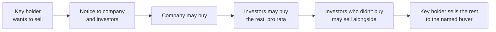

# Right of First Refusal and Co-Sale Agreement

> Legallas is an AI agent for legal work, not a lawyer or law firm. Using it creates no attorney-client relationship. AI can be wrong. Have your own lawyer review before you sign, file or rely on anything.
>
> No lawyer has reviewed this template.

## Before you use this

When a founder sells shares before the company is sold or goes public, this agreement lets the company buy them first, then the investors, and lets investors who don't buy sell alongside the founder.

| | |
|---|---|
| **Who signs** | The company, the founders and other key holders, and the investors in the priced round |
| **When** | At the closing of a priced round. Series Seed has a company right of first refusal (its section 4.3) but no co-sale; this adds both for key holders |
| **Then** | Note the restriction conspicuously on each key holder's certificate, or in the notice for uncertificated shares, or it won't bind a buyer who doesn't know of it ([7-106-208(2)][t7]; [202(a)][d8s6]) |

## The document

<!-- TEMPLATE START -->

**RIGHT OF FIRST REFUSAL AND CO-SALE AGREEMENT**

This Agreement is among {{COMPANY_NAME}}, a {{COMPANY_STATE_AND_TYPE}} (the "**Company**"), the key holders named below ({{KEY_HOLDER_NAMES}}, each a "**Key Holder**") and the investors named below ({{INVESTOR_NAMES}}, each an "**Investor**"). It takes effect on {{SIGNING_DATE}}.

**1. Terms used.** "**Shares**" means shares of the Company's capital stock a Key Holder holds now or later, and any security convertible into or giving a right to acquire them. "**Transfer**" means any sale, gift, pledge or other transfer of Shares or an interest in them, voluntary or not. "**Common Equivalent**" means shares of common stock held, plus shares of common stock issuable on conversion of shares held. "**Pro Rata Share**" means, for an Investor buying under section 4, its Common Equivalents divided by all Common Equivalents held by the Investors buying. "**Change of Control**" means a sale of all or substantially all of the Company's assets, or a merger or sale of stock after which the people who held the Company's voting stock just before it hold less than a majority of the voting power of the Company or its successor.

**2. Notice.** A Key Holder who proposes to Transfer Shares shall first give the Company and each Investor written notice of the number of Shares, the price and other terms, and the proposed buyer ("**Notice**").

**3. The Company's right.** The Company may buy all or part of the Shares on the terms in the Notice by written notice within {{NOTICE_DAYS}} days after it receives the Notice, subject to any approval its charter requires. A Key Holder who is a director doesn't vote on whether the Company buys. Any purchase must meet the legal limits on distributions. For a Key Holder's Transfer, this section applies instead of any first refusal in the Company's bylaws.

**4. The Investors' right.** If the Company doesn't buy all the Shares, the Company shall tell the Investors within 5 days after its period ends. Each Investor may then buy up to its Pro Rata Share of the Shares the Company didn't buy, on the terms in the Notice, by written notice within {{NOTICE_DAYS}} days after the Company's notice. An Investor who buys its full share may say how many more it would buy, and any Shares left are divided among them in proportion to their Pro Rata Shares. Purchases under sections 3 and 4 go ahead only if, together, they cover all the Shares, unless the Key Holder agrees to a partial sale.

**5. Co-sale.** If the Company and the Investors together don't buy all the Shares, the Company shall tell each Investor within 5 days after the period in section 4 ends. Each Investor that didn't buy may then, by written notice within 10 days, sell to the proposed buyer, on the same terms, part of its own Common Equivalents. The number it may sell is the Shares left times a fraction: its Common Equivalents, divided by the Key Holder's Shares plus the Common Equivalents of every Investor choosing to sell. The Key Holder shall reduce the Shares it sells by that many. If the buyer won't buy from an Investor that chose to sell, the Key Holder may not sell to that buyer unless it buys the Investor's shares on the same terms. Each selling Investor gives only statements about its own title and authority, and its liability is limited to its share of the price.

**6. Closing.** Purchases under sections 3 and 4 close within 30 days after the last period in sections 3 to 5 ends, for cash or, if the Notice offered other value, its cash equivalent as the board sets in good faith. The Key Holder may then Transfer the Shares no one bought, to the proposed buyer, on terms no better for the buyer than in the Notice, within 60 days after that last period ends. After that, the Shares are again subject to this Agreement.

**7. Transfers this Agreement doesn't cover.** Sections 2 to 6 don't apply to:

(a) a Transfer by gift or on death to a family member, or to a trust or company wholly for the Key Holder's or family members' benefit, if the Key Holder keeps the vote or the transferee signs this Agreement;

(b) a Transfer to the Company, including under a repurchase right in a vesting agreement;

(c) a Transfer in a Change of Control approved under the Company's charter and any voting agreement;

(d) Transfers by a Key Holder in any 12 months of no more than {{EXEMPT_PERCENT}}% of the Shares it held at the start of those 12 months.

The transferee in (a) or (d) takes the Shares subject to this Agreement and signs it before the Transfer, or for a Transfer on death, within 30 days after.

**8. Invalid transfers.** A Transfer that breaks this Agreement is void, and the Company shall not record it. Each certificate for a Key Holder's Shares, or the notice for uncertificated Shares, shall carry this legend: "These shares are subject to a right of first refusal and a co-sale right in an agreement with the corporation, a copy of which is on file at its principal office."

**9. Ending.** This Agreement ends when the Company's common stock is first sold in a registered public offering, when a Change of Control closes, or when no Investor holds shares.

**10. General.** This Agreement is governed by the laws of {{GOVERNING_STATE}}, without its conflict of law rules. The Company, the Key Holders holding a majority of the Shares and the Investors holding a majority of the shares held by all Investors may amend or waive it in writing, and that binds everyone, except that a change that treats one party differently from others like it needs that party's consent. Notices are in writing to the addresses on the Company's records; email counts if the recipient confirms it. If a court finds any term unenforceable, the rest stands. It may be signed in counterparts and electronically.

{{COMPANY_NAME}}

By: ______________________________

Key Holders: ______________________________

Investors: ______________________________

Legallas template raise/rofr-co-sale-agreement version 1. Law checked 2026-11-02. Not reviewed by a lawyer. Have your own lawyer review. Delete this line before signing.

<!-- TEMPLATE END -->

## Drafting notes

| Choice | Options | Recommendation and why | Where a lawyer should look |
|---|---|---|---|
| Who is bound | Key holders only, as drafted; every common holder | **Key holders only.** The bylaws' first refusal already covers everyone else ([Colorado bylaws](../founders/colorado-corporation-bylaws.md) and [Delaware bylaws](../founders/delaware-corporation-bylaws.md), Article 7). This agreement adds the investors' rights for the people whose sales matter to them | Anyone else investors want bound |
| Notice period (3, 4) | Days filled in | **Fill in a short period,** so a founder's sale isn't held up for months | Interaction with any buyer's deadline |
| With Series Seed | Use this agreement as Series Seed's section 4.3 assignment | **Name the Major Purchasers as the Investors.** Series Seed's investment agreement requires a company right of first refusal on common stock, assigned to its Major Purchasers. Section 4 here can be that assignment | Whether the Major Purchaser shares match section 4's Pro Rata Shares |
| Small transfers (7(d)) | A percentage filled in; none | **A small percentage.** It lets a founder sell a little for personal needs without running the whole process | Whether investors accept any carve-out |
| Void transfers (8) | Void, as drafted; damages only | **Void,** with the legend. Both states enforce a noted restriction against a buyer ([7-106-208(2)][t7]; [202(a)][d8s6]) | Shares already issued: a restriction binds them only if the holder agreed, voted for it or knew of it ([7-106-208(1)][t7]) |
| Company purchase (3) | As drafted | **As drafted.** A company buying its own shares is limited by Colorado's distribution tests ([7-106-401][t7]) and Delaware's capital impairment rule ([160][d8s5]). Series Seed's charter also needs the preferred majority's approval for a repurchase (its B.2.3(d)) | Whether the purchase passes the test |

**Fights.** A founder pushed out may want to sell. This agreement gives the company and investors the first chance to buy and the right to join a sale, but no right to force one. A transfer that skips the steps is void (section 8).

## What couldn't be checked

- **Whether a court would enforce the 7(d) carve-out and section 5's buyer condition** exactly as written in each state. No case law was researched.
- **Tax effects of a co-sale** on qualified small business stock. Left to each holder's tax professional.

## Sources

[C.R.S. Title 7][t7], 2026 edition, read 2026-11-02. [8 Del. C. ch. 1, subch. V][d8s5] and [VI][d8s6], read 2026-11-02.

[t7]: https://olls.info/crs/crs2026-title-07.pdf
[d8s5]: https://delcode.delaware.gov/title8/c001/sc05/index.html
[d8s6]: https://delcode.delaware.gov/title8/c001/sc06/index.html
