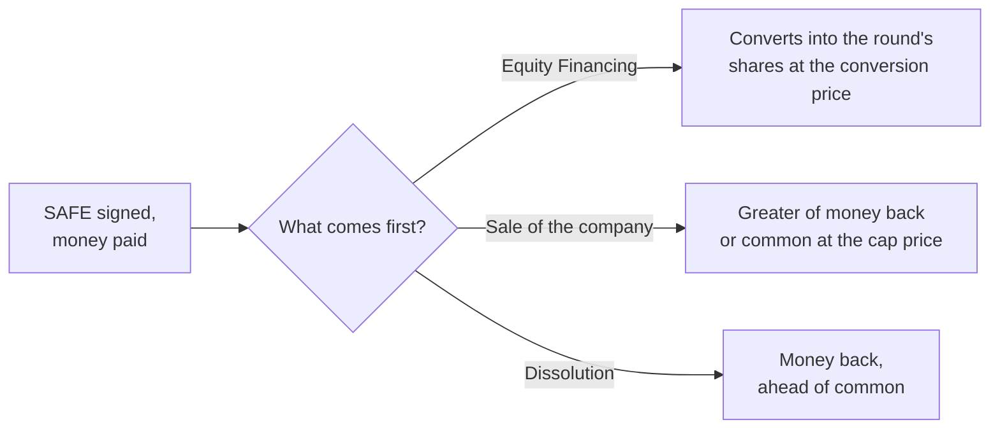

# Simple Agreement for Future Equity

> Legallas is an AI agent for legal work, not a lawyer or law firm. Using it creates no attorney-client relationship. AI can be wrong. Have your own lawyer review before you sign, file or rely on anything.
>
> No lawyer has reviewed this template.

## Before you use this

A SAFE is money now for stock later. Unlike a [convertible note](convertible-note.md), it isn't debt: no interest, no maturity date, no right to be repaid on a date. This is Legallas's own SAFE. The Y Combinator SAFE stays [pinned unmodified](../bundled-forms.md#pinned-files) for rounds that use it.

| | |
|---|---|
| **The law** | Delaware: a corporation "may create and issue ... rights or options entitling the holders thereof to acquire from the corporation any shares of its capital stock", on terms "set forth in a resolution of the board of directors" ([8 Del. C. 157(a), (b)][d8sc5]). Colorado: "Rights" include "convertible securities entitling the holders thereof to purchase, receive, or acquire shares", and "The board of directors shall determine the terms" ([C.R.S. 7-106-205(1)(a), (2)][crs7]) |
| **Corporations only** | It converts into stock. A Colorado LLC uses the [convertible note](convertible-note.md) or [admits investors](llc-investor-admission.md) |
| **Before signing** | The board approves the SAFEs and this form ([financing consents](financing-consents.md)). The [offering record](offering-record.md) is open. Each investor signs an [accredited investor certification](../investors/angels/accredited-investor.md) |
| **Who signs** | The company and each investor, all on the same terms |
| **Deadline** | Form D "no later than 15 calendar days after the first sale of securities in the offering" ([230.503(a)(1)][e503]). State notices: [Colorado securities filings](colorado-securities-filings.md) |

## The document

<!-- TEMPLATE START -->

**SIMPLE AGREEMENT FOR FUTURE EQUITY**

THIS AGREEMENT AND ANY SECURITIES ISSUED UNDER IT HAVE NOT BEEN REGISTERED UNDER THE SECURITIES ACT OF 1933 OR ANY STATE SECURITIES LAW. THEY MAY NOT BE SOLD OR TRANSFERRED UNLESS REGISTERED OR UNLESS AN EXEMPTION FROM REGISTRATION IS AVAILABLE.

Purchase Amount: {{PURCHASE_AMOUNT}}. Issue date: {{ISSUE_DATE}}.

{{HOLDER_NAME}} (the "**Holder**") has paid the Purchase Amount to {{COMPANY_NAME}}, a {{COMPANY_STATE_AND_TYPE}} (the "**Company**"). In return, the Company grants the Holder the right to receive shares of its capital stock on the terms below. This agreement is one of the Company's simple agreements for future equity issued on these terms (the "**SAFEs**").

**1. Terms used.**

"**Change of Control**" means a sale of all or substantially all of the Company's assets, or a merger or sale of stock after which the people who held the Company's voting stock just before it hold less than a majority of the voting power of the Company or its successor. A financing whose main purpose is raising money isn't a Change of Control.

"**Equity Financing**" means the first sale of the Company's preferred stock after the issue date, mainly to raise money, at a fixed price per share, in which it receives at least {{QUALIFIED_FINANCING_AMOUNT}} in cash in total, counting all closings of that round and not counting the conversion of the SAFEs or any convertible notes.

"**Fully Diluted Capitalization**" means, immediately before the relevant event and as converted to common, with each share counted once: all outstanding shares, all shares issuable on exercise or conversion of outstanding options, warrants and convertible securities, and all shares reserved but not yet granted under any equity plan, but not counting the SAFEs or any convertible notes.

"**Majority Holders**" means the holders of a majority of the total Purchase Amounts of all outstanding SAFEs.

"**Round Price**" means the price per share paid in cash by the new investors in the Equity Financing.

**2. Not a loan.** This SAFE bears no interest, has no maturity date and gives no right to repayment except under sections 4 and 5.

**3. Conversion in an Equity Financing.** If an Equity Financing closes while this SAFE is outstanding, it converts automatically, at the first closing, into shares of the series sold in it. The number of shares is the Purchase Amount divided by a conversion price equal to:

[OPTION A: A discount and a cap.]
the lower of (a) the Round Price less {{DISCOUNT_PERCENT}}%, and (b) {{VALUATION_CAP}} divided by the Fully Diluted Capitalization.
[END OPTION A]

[OPTION B: A cap only.]
the lower of (a) the Round Price and (b) {{VALUATION_CAP}} divided by the Fully Diluted Capitalization.
[END OPTION B]

[OPTION C: A discount only.]
the Round Price less {{DISCOUNT_PERCENT}}%.
[END OPTION C]

The Holder shall sign the documents that the new investors sign, on the same terms except price and any term given only to a lead investor. The Company issues no fractional share; it pays the value of any fraction in cash.

**4. Change of Control.** The Company shall give the Holder at least 10 days' notice before a Change of Control closes. If one closes while this SAFE is outstanding, the Holder receives at closing the greater of:

(a) the Purchase Amount; and

(b) what the Holder would receive as the holder of a number of common shares equal to the Purchase Amount divided by the Cap Price, paid with the other common holders in the same form. The Cap Price is {{VALUATION_CAP}} divided by the Fully Diluted Capitalization.

If there is no valuation cap, (a) applies.

**5. Dissolution.** If the Company dissolves, winds up or makes a general assignment for the benefit of creditors while this SAFE is outstanding, the Holder receives the Purchase Amount.

**6. Ranking.** A payment under section 4(a) or section 5 comes after the Company's debts, equal with the other SAFEs and any preferred stock's liquidation preference, and ahead of common stock. If the money isn't enough to pay all of them in full, it is shared in proportion to the amounts due. Under section 4(b), the Holder is paid as a common holder.

**7. End.** This SAFE ends when the Company issues the shares under section 3 or pays what is due under section 4 or 5.

**8. The Company's statements.** The Company states that: (a) it is validly existing and in good standing in its state; (b) its board has approved this SAFE and the SAFEs, and they are its valid and binding obligations; and (c) shares issued under this SAFE will be validly issued, fully paid and nonassessable. The Company shall authorize and reserve enough shares to issue them when due.

**9. The Holder's statements.** The Holder states that: (a) it is an "accredited investor" as defined in Rule 501(a) of Regulation D, and lives in, or has its principal place of business in, {{HOLDER_STATE}}; (b) it is buying this SAFE for its own account, not to resell it; (c) it understands that this SAFE and any shares issued under it aren't registered, can't be resold without registration or an exemption, and will carry a legend; (d) it can bear the loss of the whole Purchase Amount; (e) it had the chance to ask questions and get answers about the Company; and (f) it didn't learn of this investment through any general solicitation or general advertising, unless the Company told it the offering relies on Rule 506(c).

**10. No stockholder rights.** Until it converts, this SAFE gives no vote, dividend or other right of a stockholder.

**11. Amendment and waiver.** The Company and the Majority Holders may amend or waive any term of all SAFEs in writing, and that binds every Holder, as long as it treats all SAFEs the same way. Changing this SAFE's Purchase Amount, section 3 or section 6 needs the Holder's own consent.

**12. Transfer.** The Holder may not transfer this SAFE without the Company's written consent and an exemption from registration. A transfer to an affiliate of the Holder needs only the exemption and written notice to the Company.

**13. Taxes.** Each party pays its own taxes. The Company makes no statement about how this SAFE is treated for tax purposes.

**14. General.** This SAFE is governed by the laws of {{GOVERNING_STATE}}, without its conflict of law rules. Notices are in writing and go to the Company at {{COMPANY_ADDRESS}} and to the Holder at {{HOLDER_ADDRESS}}, or to a later address given by notice; email counts if the recipient confirms it. If a court finds any term unenforceable, the rest stands. This SAFE may be signed in counterparts and electronically.

Signed on {{SIGNING_DATE}}.

{{COMPANY_NAME}}

By: ______________________________

Accepted and agreed:

______________________________
{{HOLDER_NAME}}

Legallas template raise/safe version 1. Law checked 2026-11-13. Not reviewed by a lawyer. Have your own lawyer review. Delete this line before signing.

<!-- TEMPLATE END -->

**Example, invented.** Harbor Labs, Inc., a Delaware corporation, takes $50,000 from one angel on this SAFE with Option B and a $6,000,000 cap. Doe files the signed copy as DOE-0061 and Form D within 15 calendar days. A year later a $1,500,000 Series Seed closes at a price above the cap price, so the SAFE converts at the cap price.

## Drafting notes

| Choice | Options | Recommendation and why | Where a lawyer should look |
|---|---|---|---|
| Which SAFE | This one; the pinned Y Combinator form | **One form per round.** Two forms in one round convert on different math. This one measures the cap before the SAFEs convert, like the Legallas note | What the round's investors expect |
| Cap measure (1) | Excludes SAFEs and notes, as drafted; includes them | **As drafted.** Each holder's share then moves as more SAFEs are added. Including them fixes each holder's percentage and dilutes founders more | Rounds with notes and SAFEs both outstanding |
| Minimum round (1) | An amount filled in; any priced round | **A real round's size.** A small insider sale at a fixed price could otherwise force conversion | The amount against the expected seed round |
| Discount and cap (3) | A, both; B, cap only; C, discount only | **The company's choice; Legallas picks none.** A cap protects the holder if the round prices high; a discount rewards early money if it prices low | Option pool increases in the round |
| Sale of the company (4) | Greater of money back or common at the cap, as drafted; money back only | **As drafted.** The holder shares upside without jumping ahead of preferred stock, since 4(b) pays as common | Payment priority at closing |
| Ranking (6) | Equal with preferred, as drafted; behind preferred | **As drafted.** The SAFE money came in before or beside the preferred money | Any existing preferred stock's terms |
| Majority amendment (11) | Majority Holders, as drafted; each holder | **Majority Holders.** One holdout can't block a fix, while section 11 protects each holder's amount, price and ranking | Whether any holder needs a veto |
| Tax (13) | No position, as drafted; a stated treatment | **No position.** Each holder's tax professional decides | Each holder's own tax position |

## What couldn't be checked

- **How a SAFE is taxed.** No Internal Revenue Code section or IRS ruling on SAFEs was read.
- **Court decisions on SAFEs** in Colorado or Delaware weren't researched.
- **Market cap and discount levels.** The template sets none.

## Sources

Read 2026-11-13: [8 Del. C. chapter 1, subchapter V][d8sc5], sections 152 and 157; [C.R.S. title 7][crs7] (2026 edition), 7-106-205; eCFR, current as of 2026-11-10, [17 CFR 230.503][e503] and [230.506][e506].

[d8sc5]: https://delcode.delaware.gov/title8/c001/sc05/index.html
[crs7]: https://olls.info/crs/crs2026-title-07.docx
[e503]: https://www.ecfr.gov/current/title-17/section-230.503
[e506]: https://www.ecfr.gov/current/title-17/section-230.506
