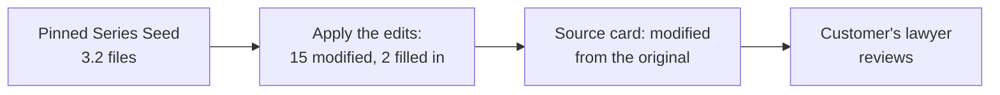

# Series Seed for a Colorado Corporation

> Legallas is an AI agent for legal work, not a lawyer or law firm. Using it creates no attorney-client relationship. AI can be wrong. Have your own lawyer review before you sign, file or rely on anything.
>
> No lawyer has reviewed these edits.

## Before you use this

Series Seed is written for a Delaware corporation. Its CC0 dedication lets anyone change it, so this record lists every change that fits it to a Colorado corporation. The install applies these edits to the [pinned files](../bundled-forms.md#pinned-files) and shows the result as modified from the original, with this list, as the [product notices](../../docs/legal/product-notices.md) A5 require.

| | |
|---|---|
| **Covers** | Term sheet, investment agreement and restated charter: a priced seed round in a Colorado corporation |
| **Doesn't cover** | A co-sale right, management rights letter or director indemnification agreement: see the [templates index](../README.md#path-2-startups-raise) |
| **Approvals** | [Financing consents](financing-consents.md): the board adopts and recommends; the shareholders approve, with the common voting as its own group ([7-110-103][t7]; [7-110-104(1)(f)][t7]) |
| **Filing** | Articles of restatement with the Colorado Secretary of State ([7-110-107(4)][t7]) |
| **Keep** | Series Seed's own disclaimer, as [bundled-forms.md](../bundled-forms.md) requires |
| **Not endorsed** | Neither the Series Seed author nor Fenwick & West has reviewed or endorsed these edits |

## The edits

Quoted words are from Series Seed 3.2. "Articles template" means the Legallas [Colorado articles of incorporation](../founders/colorado-corporation-articles.md). Each row puts Series Seed's words beside the change, marked:

| Shown as | Means | Edits | Count |
|---|---|---|---|
| **Modified** | Series Seed's words are replaced, deleted or added to | T2, I2, C1 to C4, C6, C7, C9 to C13, C16, C17 | 15 |
| Filled in | A blank or bracketed term gets its answer | T1, I1 | 2 |
| Unchanged | The words stay; the row says why, or what else to do | I3, I4, C5, C8, C14, C15 | 6 |

The [source card](#source-card) lists only the **Modified** rows.

### Term sheet

| # | Shown as | Where | Series Seed says | Change to | Why |
|---|---|---|---|---|---|
| T1 | Filled in | Opening | "a *[Delaware]* corporation" | "a Colorado corporation" | The issuer |
| T2 | **Modified** | Documentation | "identical to the Series Seed Preferred Stock documents published at www.seriesseed.com, except for the modifications set forth in this Term Sheet" | "the Series Seed Preferred Stock documents, version 3.2, with the Colorado edits in Legallas record raise/series-seed-colorado version 1, and the modifications set forth in this Term Sheet" | The documents are changed, and the named site redirected to an unrelated hosting page when checked on 2026-11-02 |

### Investment agreement

| # | Shown as | Where | Series Seed says | Change to | Why |
|---|---|---|---|---|---|
| I1 | Filled in | Exhibit A, "State of Incorporation", "Governing Law", "Dispute Resolution Jurisdiction" | Blanks | Fill each blank with "Colorado" | Fill-ins only |
| I2 | **Modified** | 1.1.1 | "(e.g. certificate of incorporation)" | "(articles of restatement and restated articles of incorporation)" | Colorado's term ([7-110-107][t7]) |
| I3 | Unchanged | 3.6 (legends); 5.1, 5.2, 5.3 and 8.1 (transfer limits) | Legends and transfer limits | No change to the text. Note the limits conspicuously on each certificate, or in the information statement for uncertificated shares | Otherwise they don't bind a transferee without knowledge ([7-106-208(2)][t7]) |
| I4 | Unchanged | 5.3 and 7.1 | Drag-along and board voting | No change | Colorado makes a shareholders' voting agreement specifically enforceable ([7-107-302][t7]) |

### Restated charter

| # | Shown as | Where | Series Seed says | Change to | Why |
|---|---|---|---|---|---|
| C1 | **Modified** | Cover certificate, before Exhibit A | Restated under "Sections 242 and 245" and approved under "Section 228 of the General Corporation Law" | Delete. File articles of restatement through the Secretary of State's online form, with Exhibit A as the text | Colorado's route ([7-110-107(4)][t7]; [7-110-103][t7]) |
| C2 | **Modified** | Throughout | "Restated Certificate of Incorporation", "Restated Certificate", "certificate of incorporation" | "Restated Articles of Incorporation", "Restated Articles", "articles of incorporation" | Colorado's terms |
| C3 | **Modified** | Article II | Delaware registered office and agent | The registered agent's name and address, and the principal office address, as on the Secretary of State's record | Colorado's articles name these ([7-102-102(1)(c), (d)][t7]) |
| C4 | **Modified** | Article IV | "any lawful act or activity for which corporations may be organized under the General Corporation Law" | "any lawful business" | [7-103-101(1)][t7] |
| C5 | Unchanged | Article V, A.2 | "Unless required by law, there shall be no cumulative voting." | Keep | Without it, cumulative voting is mandatory in Colorado ([7-102-102(3)][t7]) |
| C6 | **Modified** | Article V, A.2 | The sentence "The number of authorized shares of Common Stock may be increased or decreased ... irrespective of the provisions of Section 242(b)(2) of the General Corporation Law." | Delete the whole sentence | Colorado gives a class its own voting group vote on a change to its authorized shares, even if the articles call it nonvoting, and has no opt-out like 242(b)(2) ([7-110-104(1)(a), (4)][t7]) |
| C7 | **Modified** | Article V, A.2, and the written consent words in B.2.1 | A.2: votes "at all meetings of stockholders (and written actions in lieu of meetings)" | Add article 7 of the articles template, with the option the founders chose | Less than unanimous written consent works only if the articles expressly allow it ([7-107-104(1)(b)][t7]) |
| C8 | Unchanged | Article V, B.2.2 | Directors elected by class, removable by that class | Keep | Articles may let a class elect directors, and only that voting group removes them ([7-108-104][t7]; [7-108-108(2)][t7]) |
| C9 | **Modified** | Article V, B.8 | "electronic communication in compliance with the provisions of the General Corporation Law" | "electronic transmission, as section 7-90-105 of the Colorado Revised Statutes allows" | Colorado's notice section; email notice to an owner needs a prominent legend that it is an important notice ([7-90-105(5)][t7]) |
| C10 | **Modified** | Article VII | Repurchases measured under "Section 500 of the California Corporations Code" | "Under section 7-106-401(3)(b) of the Colorado Revised Statutes, the preferential rights of the Preferred Stock on dissolution are not added to liabilities when measuring a distribution for (i) a repurchase of Common Stock from an employee, officer, director or consultant on the end of service under an agreement giving that right, (ii) a repurchase of Common Stock from any of them under a right of first refusal in an agreement, (iii) a repurchase of Common Stock or Preferred Stock to settle a dispute with a shareholder, or (iv) any other repurchase or redemption the holders of the Preferred Stock approve." | Colorado's distribution test adds senior preferential rights "unless the articles of incorporation permit otherwise" ([7-106-401(3)(b)][t7]); the California reference does nothing here |
| C11 | **Modified** | Article VIII, D | Meetings and books "within or without the State of Delaware" | "within or outside Colorado" | Delaware reference |
| C12 | **Modified** | Article IX, A | Director liability limited under the General Corporation Law | Article 10 of the articles template | It tracks Colorado's list of what can't be limited ([7-102-102(2)(d)][t7]) |
| C13 | **Modified** | Article IX, B | Indemnification beyond "Section 145 of the General Corporation Law" | Article 11 of the articles template | Colorado's indemnification is article 109, and the articles may require it ([7-109-109][t7]) |
| C14 | Unchanged | Article X | Renounces any "Excluded Opportunity" for non-employee directors and preferred holders | Keep | Colorado articles may renounce specified corporate opportunities ([7-102-102(2)(e)][t7]; [7-103-102(1)(s)][t7]) |
| C15 | Unchanged | Article V, B.1.3.1(a) | "merger or consolidation" | Keep | Colorado has mergers but no consolidations; the extra word does no harm |
| C16 | **Modified** | New articles | Nothing | Carry over articles 8 and 9 of the articles template, and any other article of the original articles the founders want to keep | Restated articles replace the original articles whole ([7-110-107][t7]) |
| C17 | **Modified**, if it applies | Article V, opening | "$[par value] per share" | "without par value", if the original articles said so | Matches the articles template; par is optional in Colorado ([7-102-102(2)(b)(IV)][t7]) |

## Source card

Shown on screen beside the three modified files, never inside them, in the [product notices](../../docs/legal/product-notices.md) A5 format. The other forms' cards are in [`bundled-forms.md`](../bundled-forms.md#source-cards).

> **Series Seed 3.2 for a Colorado corporation: term sheet, investment agreement, restated articles**
> Source: Series Seed · Version 3.2, commit 3789fa0 · Retrieved 2026-11-02 · github.com/seriesseed/equity
> Licence: CC0, a public-domain dedication. Anyone may copy, change and sell it without asking.
> Law checked: 2026-11-02. Written for: Colorado corporation
> Not reviewed by a lawyer. It's a starting point, and it may not fit your facts. Have your own lawyer review before you sign.
> Published under CC0. Delaware corporations, or Colorado corporations with the edits Legallas lists. Financing documents only. Not endorsed by the Series Seed author or Fenwick & West. Modified from the original: T2, I2, C1 to C4, C6, C7, C9 to C13, C16 and C17 (C17 only where the original articles had no par value), in Legallas record raise/series-seed-colorado version 1.

## Drafting notes

| Choice | Options | Recommendation and why | Where a lawyer should look |
|---|---|---|---|
| Base | Series Seed with these edits; an original Colorado set | **Series Seed with these edits.** It's a short, complete, published set, and CC0 lets it be changed. An original set would mean three long documents drafted from nothing | Whether Series Seed's 2014 terms still fit today's practice |
| Written consent (C7) | Advance notice; notice afterward; unanimous | **The option in the original articles,** so the restated articles don't silently change how holders act | Whether investors ask for a different choice |
| Voting groups | Accept Colorado's class votes | **Accept them.** The common, as its own group, votes on creating the preferred, on changes to its own authorized shares and on later increases of the preferred ([7-110-104(1)(a), (f), (g)][t7]). Series Seed's protective provisions already give the preferred its own vote | A founder group that holds most of the common gets a real veto |
| Article VII (C10) | Colorado text; delete | **Colorado text.** Without it, a buy-back of a departing employee's unvested shares must also pass a test that adds the preferred's liquidation preference to liabilities | Whether the board's determination is documented |

**Fights.** The restated articles decide who elects which directors and who can block a sale or new money. In Colorado, the common's own voting group vote (C6, and the table above) is a lever the Delaware form doesn't give.

## What couldn't be checked

- **Whether the restated articles must repeat the registered agent and principal office** (C3). Section 7-102-102(1) requires them in original articles; the online restatement form wasn't opened.
- **Series Seed's 2014 terms against current practice,** such as the 25% thresholds in the charter (Article III and B.2.3) and the $10,000 counsel fee in the term sheet. Not researched.
- **Article X and officers.** Colorado adds conditions when a renouncement reaches an officer ([7-102-102(2)(e)][t7]). Series Seed reaches non-employee directors and preferred holders; a lawyer should check any non-employee officer.

## Sources

| Source | Read |
|---|---|
| [C.R.S. Title 7][t7], 2026 edition | 2026-11-02; 7-102-102 again on 2026-11-13, for C17's par value cite |
| Series Seed 3.2, [pinned](../bundled-forms.md#pinned-files) | 2026-11-02; the four files again on 2026-11-13: each SHA-256 matched, and every quoted phrase above was found in them |

[t7]: https://olls.info/crs/crs2026-title-07.pdf
