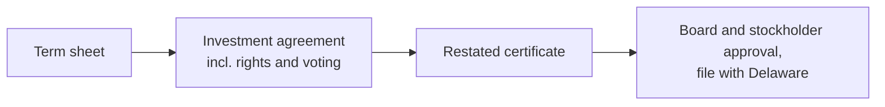

# Series Seed for a Delaware Corporation

> Legallas is an AI agent for legal work, not a lawyer or law firm. Using it creates no attorney-client relationship. AI can be wrong. Have your own lawyer review before you sign, file or rely on anything.
>
> No lawyer has reviewed this record.

## Before you use this

Series Seed is written for a Delaware corporation, so for one it ships **unmodified**. This record is the map: which file does what, where the investor-rights and voting terms sit, and what the company does around the form. The three files are [pinned by address and SHA-256](../bundled-forms.md#pinned-files); a copy whose hash differs isn't the form recorded here. For a Colorado corporation, use [the Colorado edits](series-seed-colorado.md) instead.

| | |
|---|---|
| **Covers** | A priced seed round in a Delaware corporation: term sheet, investment agreement, restated certificate of incorporation |
| **Doesn't cover** | A co-sale right ([ROFR and co-sale](rofr-co-sale-agreement.md)), a management rights letter ([letter](management-rights-letter.md)), director indemnification ([agreement](director-indemnification.md)) |
| **Approvals** | The board adopts the restated certificate and the stockholders approve it ([financing consents](financing-consents.md); [8 Del. C. 242][d242], [245][d245]); consent without a meeting follows [8 Del. C. 228][d228] |
| **Filing** | The restated certificate goes to the Delaware Division of Corporations ([8 Del. C. 245][d245]) |
| **Keep** | Series Seed's own disclaimer, as [bundled-forms.md](../bundled-forms.md) requires |
| **Age** | The form is from 2014. Its numbers, such as the thresholds in the charter and the counsel fee in the term sheet, are the 2014 numbers. A lawyer checks them against today's market |
| **Not endorsed** | Neither the Series Seed author nor Fenwick & West has reviewed or endorsed this record |

## What each checklist item is, in this form

The investment agreement carries the investor-rights and voting terms inside it, so there's no separate rights or voting agreement in this set. Section numbers are those of the pinned investment agreement, read 2026-11-13.

| Checklist item | Where it sits in Series Seed 3.2 | What the company records |
|---|---|---|
| Term sheet | The term sheet file | Who signed it and the date; whether it binds, as its own terms say |
| Preferred stock purchase agreement | The investment agreement: purchase and sale (1), the company's representations (2), the purchasers' representations (3) | Each purchaser, amount and closing date, in its schedule of purchasers |
| Restated charter | The restated certificate file | Board and stockholder approval, the filing date, the file-stamped copy |
| Investors' rights agreement | The investment agreement: information rights (4.1), the company's preemptive rights (4.3), participation right (6) | Which holders have each right, and the delivery dates for what the company owes |
| Voting agreement | The investment agreement: board election and voting (7.1), drag along (5.3 and 5.4) | The agreed board seats, and who must vote for what |

## Around the form

| Step | Done | Date | Proof |
|---|---|---|---|
| Each file's SHA-256 matches the pinned value | [ ] | __________ | The check's output |
| Blanks and bracketed terms filled in, nothing else changed | [ ] | __________ | A comparison against the pinned file |
| Board adopts and recommends the restated certificate | [ ] | __________ | Board consent |
| Stockholders approve it | [ ] | __________ | Stockholder consent or minutes |
| Restated certificate filed | [ ] | __________ | File-stamped copy |
| Investment agreement signed by the company and each purchaser | [ ] | __________ | Signed copies, one per purchaser |
| Stock issued and recorded | [ ] | __________ | [Stock ledger](../founders/stock-ledger.md) |
| Federal exemption and filings | [ ] | __________ | [Offering record](offering-record.md) |

## Source card

Shown on screen beside the three files, never inside them, in the [product notices](../../docs/legal/product-notices.md) A5 format.

> **Series Seed 3.2 for a Delaware corporation: term sheet, investment agreement, restated certificate**
> Source: Series Seed · Version 3.2, commit 3789fa0 · Retrieved 2026-11-02 · github.com/seriesseed/equity
> Licence: CC0, a public-domain dedication. Anyone may copy, change and sell it without asking.
> Law checked by Legallas: not checked. Written in 2014. Written for: Delaware corporation
> Not reviewed by a lawyer. It's a starting point, and it may not fit your facts. Have your own lawyer review before you sign.
> Shown unmodified. Not endorsed by the Series Seed author or Fenwick & West.

## What couldn't be checked

- **Series Seed's 2014 terms against current practice.** Not researched.
- **Whether a priced round needs a separate rights or voting agreement** for an investor who asks for one. This form folds both into the investment agreement; a lawyer decides if a given investor accepts that.
- **Delaware's current filing steps** for a restated certificate. The statute sections above are named, not quoted, and the Division's online flow wasn't opened.

## Sources

| Source | Read |
|---|---|
| Series Seed 3.2, [pinned](../bundled-forms.md#pinned-files) | The investment agreement's SHA-256 matched on 2026-11-13, and its section headings were read that day |
| [Delaware Code Title 8][d8] | Section numbers named only; no text quoted |

[d242]: https://delcode.delaware.gov/title8/c001/sc08/index.html
[d245]: https://delcode.delaware.gov/title8/c001/sc08/index.html
[d228]: https://delcode.delaware.gov/title8/c001/sc07/index.html
[d8]: https://delcode.delaware.gov/title8/c001/index.html
