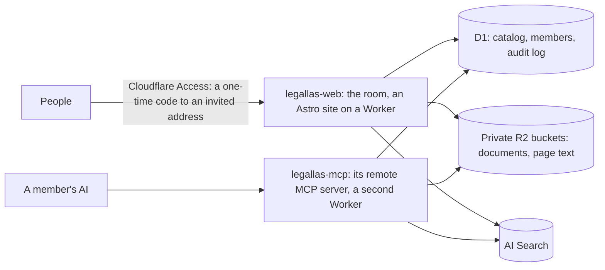
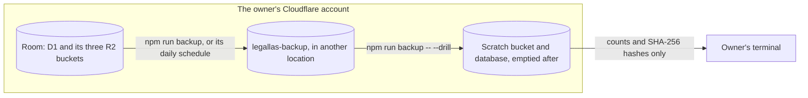
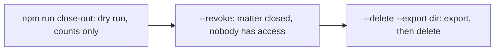
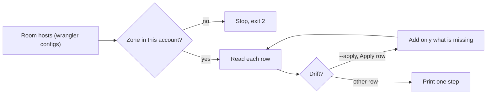
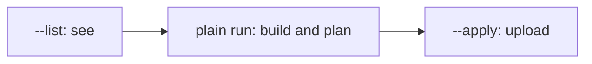

# The room



All in the owner's own Cloudflare account. Colorado Startups hosts no customer's room.

## Set up

```bash
cp wrangler.example.jsonc wrangler.jsonc
cp wrangler.mcp.example.jsonc wrangler.mcp.jsonc
cp legallas.config.example.json legallas.config.json
npm ci
```

Fill in what the examples leave empty: hostnames, the Access team and audience, database and KV IDs, alert addresses. Never commit those files. With no Access team or audience, a room refuses every request.

## Local work

| Command | Does |
|---|---|
| `npm run dev:seed` | Builds a fictional room (Doe v. Harbor Labs) |
| `npm run dev:seed -- --fixture company` | The same company, no matter |
| `npm run dev` | Serves it |
| `npm run check`, `npm test`, `npm run build` | What CI runs. `npm test` shares a process between test files that change no shared state (`scripts/run-tests.ts`) |
| `NODE_TEST_FLAGS=--experimental-test-coverage npm test` | Adds Node's coverage table, one per process |

## Cloudflare and Claude

Read before any `wrangler` command or Cloudflare API call.

| Action | Needs |
|---|---|
| Reads | Nothing |
| Deploys, `d1 migrations apply --remote` | "Production releases" |
| `d1 execute --remote` writes, `secret put`, R2 bucket, AI Search, Access, WAF and zone changes | The owner's OK for that exact change |

| Cloudflare's Workers Best Practices, not adopted | Why |
|---|---|
| Traces (`observability.traces`) | Off in all three Wrangler examples: spans can record R2 keys, URLs and so document content |
| Generated bindings types for `Env` | `npm run types` passes `--include-env=false`; `Env` and `McpEnv` stay hand-written for now |
| The Workers Vitest integration | Tests run under `node --test` with fakes; CI's Worker dry runs bundle all three Workers |

## Production releases

- [ ] A reviewed commit whose CI passed
- [ ] `npx wrangler deployments list` first
- [ ] A D1 Time Travel bookmark before applying a migration
- [ ] What you release named in `--message`
- [ ] Ask, retrieval or the prompt changed: the replica eval's release gate passed first (`.github/workflows/replica-eval.yml`)

## Backup and restore



A second Worker, `legallas-backup` (`worker/backup/`, `wrangler.backup.example.jsonc`), runs a Cloudflare Workflow. Files move bucket to bucket inside the account; nothing reaches GitHub, a laptop or a log.

| What | Copy |
|---|---|
| Original files, page text, law library (R2) | Every object, under `objects/<bucket>/<etag>/<key>`. A new version is a new copy; nothing there is overwritten or pruned |
| Catalog, members, comments, audit log (D1) | Every row of every table, 1,000 per page, under `runs/<run>/d1/` |
| Page-text search tables (`page_fts`, `page_fts_docs`) | Not copied: rebuilt from the page text after a restore |
| Run records | Manifest (key, etag, size, SHA-256 per object) and a JSON summary per run; drill results under `drills/` |

| Recovery | Point (RPO) | Time (RTO) |
|---|---|---|
| D1, within 30 days | Any minute: Time Travel (D1 docs) | One command |
| D1 database deleted, within 7 days | Nothing lost: D1 undelete (D1 changelog, 2026-10-23) | One API call |
| D1 or an R2 bucket, from the backup | The last finished backup: 24 hours with the schedule on | The drill measures it. Goal: under 1 hour for a 1 GB room |

**Set up once.** The owner's OK first: these create buckets and a database. `enam` is for a room in `wnam`; pick any location but the room's.

```bash
npx wrangler r2 bucket create legallas-backup --location enam
```

```bash
npx wrangler r2 bucket create legallas-scratch --location enam
```

```bash
npx wrangler d1 create legallas-scratch --location enam
```

```bash
npx wrangler r2 bucket lock add legallas-backup --name keep-objects-30-days --prefix objects/ --retention-days 30
```

Then copy `wrangler.backup.example.jsonc` to `wrangler.backup.jsonc`, fill in the two database IDs, and run `npm run backup:deploy`.

| Command | Does |
|---|---|
| `npm run backup` | Copies what is new since the last run, then prunes run folders older than 35 days (the newest 3 stay) |
| `npm run backup -- --drill` | Restores the newest run into the scratch copies. R2 checks every file's SHA-256 on write; every table is read back and hashed. Prints PASSED or FAILED, then empties the scratch copies |
| `npm run backup -- --restore <run> --only files,d1 --yes` | The same restore into the room's own buckets or database. Refuses any that is not empty |
| Daily | Add `"schedules": ["23 8 * * *"]` to the Workflow in `wrangler.backup.jsonc`, then `npm run backup:deploy`. Off until then |

| Drill | |
|---|---|
| When | At least every 90 days, and after any change to `worker/backup/` (product goal) |
| Proof | Objects, bytes and the manifest hash per bucket; rows and hash per table. All must match what the run recorded |
| Record | `drills/<UTC time>.json` in the backup bucket |
| In CI | `worker/backup/backup.test.ts` runs backup, drill and restore on the fictional room |

| Loss | Restore |
|---|---|
| Bad rows or a bad migration | `npx wrangler d1 time-travel restore legallas --timestamp <UTC time>` |
| The D1 database | Create one (`npx wrangler d1 create legallas --location <the room's>`), put its ID in both Wrangler configs, `npm run backup:deploy`, `npm run backup -- --restore <run> --only d1 --yes`, deploy the room, then `node scripts/fts-index.ts` |
| An R2 bucket | Create it again, empty, under its old name; `npm run backup -- --restore <run> --only files --yes` (or `index`, `law`) |
| One file | Every version stays under `objects/files/<etag>/<key>`. A one-file command is not built yet |

| Guard | |
|---|---|
| Storage | A backup or drill stops before the buckets it sees would pass 9 GB, 90% of R2's free 10 GB a month (R2 pricing page, read 2026-11-06) |
| Writes | At most 100,000 a run, 10% of R2's free 1 million Class A operations a month (same page) |
| Location | `npm run backup` refuses a backup bucket in the same location as `legallas-files` |
| Scratch | The drill refuses a scratch bucket holding anything outside `drill/`, and a scratch database holding tables without its marker |
| Config | `worker/backup/config.test.ts` and `npm run backup`: the room's own bucket and database names, scratch and backup never one of them, no route, no workers.dev URL |

## The MCP server

| | |
|---|---|
| `legallas-mcp` (`mcp/`) | A Worker apart from the room: a remote MCP server for members' AI tools, read-only except for proposals a person approves in the room, on the same D1, R2 and AI Search |
| Set up | Copy `wrangler.mcp.example.jsonc` to `wrangler.mcp.jsonc`, fill in what its comments list |
| Deploy | `npm run mcp:deploy` |
| Local | `npm run mcp:dev` serves it; `npm run mcp:smoke` runs the full flow, no browser |
| Guides for each AI tool | `connect/` |
| Security page | Public `/security` beside `/connect`: the brief (`connect/security-brief.md`) with the room's names. After editing the brief: `node scripts/security-brief.ts` |

## Settings that turn features on

Each is off in the examples.

| Setting | Turns on |
|---|---|
| `PROPOSALS_ENABLED` set to `"1"`, both Workers | A member who allows it when connecting an app lets their AI propose a new draft; they approve, edit or reject it on the room's Proposals page (`worker/proposals.ts`, `../docs/design/propose-and-approve.md`). Migration 0014: proposals and their append-only history |
| `RECOMMEND` set to `"1"`, both Workers | Ask, Research mode, the connector and the room's own Copilot agent (`connect/copilot/room-package.ts`, at its next build) give every option and a recommendation, with sources and what couldn't be checked (`worker/recommend.ts`, `../docs/legal/product-notices.md` A4 and A11). Turn it on only after `replica-eval.yml` passes with it on. On or off, a decision about a named person gets none (`scripts/ask-eval.people.json`) |
| `CHECKLIST_ENABLED` set to `"1"` | The company checklist on `/checklist/` (`worker/checklist.ts`). The entity type, formation date and Colorado report month pick its items and dates. The owner sets them there (`worker/company-settings.ts`); until then, the room config's `entityType` and `formationDate` stand |

## Ask's model

| | |
|---|---|
| Default | gpt-oss-120b on Workers AI, in the room's own Cloudflare account, no other account or key. GLM-5.3 Flash until 2026-11-05: Workers AI retires it on 2026-11-15 |
| `ASK_HOST`, off by default | An open-weight model on a host the room chooses. Sends the room's documents to that host |
| `ASK-MODEL.md` | What that means, checking the host's data retention, turning it on and off |

## Spend budget

Every Workers AI or AI Search call goes through the metered bindings (`worker/spend.ts`) or a script's spend lease (`scripts/spend-guard.ts`). Limits change only in `worker/budget.ts`, by review: Cloudflare has no hard cap, so they are the stop.

## Security model

Whole picture: `../SECURITY.md`.

| Who | Gets |
|---|---|
| Invited members | In. Each call re-reads the member's row |
| A member before ticking the full notice ([A3](../docs/legal/product-notices.md)) | `/notice/` and sign-out; no AI sign-in or tool call. Ticks: `notice_acks`, per version; owner sees them on Activity (`worker/notice-gate.ts`) |
| The assistant (`ASSISTANT_NAME`, `assistantName`) | No lawyer-like name (A1): build and `config.test.ts` fail; Worker shows "Legallas" (`worker/room-names.ts`) |
| `ROOMS_ENABLED` "1": people invited to a deal or matter room (`npm run room`) | That room's guest routes only (`worker/rooms.ts`) |
| A deal-room investor's AI (`ROOMS_ENABLED` "1" on `legallas-mcp` too; off in both examples, and `config.test.ts` fails when the two Workers differ) | Read-only tools over their rooms, never privileged (`worker/privilege.ts`) |
| The owner, counsel members | Privileged folders |
| A member's AI | Every read in the audit log, with the app's name |

| Control | What it does |
|---|---|
| `REQUIRE_MFA` "1", on both Workers | A sign-in whose Access token names no second factor (RFC 8176 `amr`: a security key, or a biometric such as Touch ID, Face ID or Windows Hello; never `otp` or `mfa`, which an emailed code can carry) is refused, with a link to `https://<team>.cloudflareaccess.com/AddMfaDevice`. Room and AI sign-in alike. Off by default. Never the localhost dev identity (`worker/mfa.ts`) |
| Member changes | One append-only `access_events` row per add, role change and removal: who ran it (wrangler's login), the email, the role. `npm run member -- history [email]` lists them |
| Offboarding | `npm run member -- remove <email>` with `LEGALLAS_ACCESS_API_TOKEN` set: removes the email from the room's Access policies, reads each back, ends their Access sessions, records each step. Unset: prints the two steps (`scripts/access-offboard.ts`) |

Turning on `REQUIRE_MFA`, in this order. Steps 2 and 4 are the owner's check: the second-factor claim is built from Cloudflare's docs, not seen on a live token. Record both results, with the date, before relying on MFA. `"0"` stays the default until then.

1. Set `"REQUIRE_MFA": "1"` in `wrangler.jsonc` and `wrangler.mcp.jsonc`. Only `"0"` or `"1"`: anything else leaves it off and logs `mfa_setting_invalid`. Deploy both.
2. Check: sign in with the emailed code only. The room must show "Add a second sign-in step". If it lets you in, the code alone counts as a second factor: set `"0"`, deploy, and open an issue.
3. Zero Trust > Access controls > Access settings: allow security keys and biometrics. An authenticator app's code is not counted. Require MFA on both room applications.
4. Check: add one at `/AddMfaDevice`, sign out, sign in. You are in. If not: set `"0"`, deploy, and open an issue.

`LEGALLAS_ACCESS_API_TOKEN`: the owner's own Cloudflare API token, for the room's account only, with `Access: Apps and Policies Write` and `Access: Organizations, Identity Providers, and Groups Write` (shown as Edit in the dashboard). Set it only for the `member remove` command. Never in a Wrangler config or `.dev.vars`.

A room's documents, names and settings never enter this repository. Sync without an account-wide credential: [`docs/design/sync-endpoints.md`](../docs/design/sync-endpoints.md).

### Quarterly access review

`npm run access-review` (`-- --local` for the local room), on the owner's own machine, never in CI: every member with role, last sign-in and last AI use; every live AI connection with app and last use; every guest invitation with status and expiry. Read-only. It flags anything unused in 90 days (source: `FLAG_ACTIONS` in `scripts/access-review.ts`, which wins):

| Flag | Do |
|---|---|
| `no-sign-in` | Still needed? Recent AI use means they work through their AI: keep. Else `npm run member -- remove <email>`, then revoke their Access sessions |
| `ai-unused` | Revoke it on the MCP server's `/connections` page. The member can reconnect |
| `ai-not-member` | Revoke it on `/connections` now |
| `guest-no-sign-in` | Still needed? Else `npm run room -- revoke <room-id> <email>` |

## Retention and close-out

| Data | Kept | Removed by |
|---|---|---|
| Originals a sync replaced or removed | 30 days (`worker/sync-rules.ts` `RETAIN_DAYS`), longer while version history keeps them | Sync's purge |
| Research chat threads | 90 days after last use | The thread itself. A hold doesn't stop this yet |
| Expired AI connections and tokens | Until they expire | `legallas-mcp`'s daily cron |
| Sign-in records: email, IP, browser, country | `RETAIN_SIGNINS_DAYS`, at least 30. Unset: until close-out | The daily cron |
| The audit log, IP and browser included | `RETAIN_AUDIT_DAYS_AFTER_CLOSE` after the matter closes. Unset: until close-out | The daily cron, a chained copy saved first |
| Documents, page text, comments, members, everything else | Until close-out | `npm run close-out -- --delete` |

Both settings go in `wrangler.mcp.jsonc` (its comments say how). Unset, `""` or `"0"`: the room keeps everything.

| A legal hold that is on | |
|---|---|
| Every purge in the table | Refused, in the code and in the SQL (`NO_HOLD_SQL`, migration 0022's triggers) |
| `close-out --revoke`, `--delete` | Refused before asking, recorded in `hold_events` |

| The audit log | |
|---|---|
| Live rows | Append-only (migration 0019) |
| A purge | One D1 transaction: record it in `audit_purges`, lift the delete trigger, remove the rows the record names, restore the trigger word for word. Any failure rolls back all of it |
| Its copy | `retention/audit-log/<first>-<last>.jsonl` in the files bucket, written before the transaction |
| The chain | Each copy carries on from the one before; the room's own export carries on from the last. Every row keeps its chain |



| Step | Does |
|---|---|
| No flag | Hold, matter, members, invitations, sync tokens, AI connections; rows by table; objects and bytes by bucket |
| `--revoke` | Typed phrase. Records the close (`matter_close`), removes every member, ends invitations and sync tokens, revokes every AI connection. Each recorded |
| `--export <dir>` | `tables/<name>.jsonl`: every table's rows but sign-ins. `audit-log.jsonl` from the first row, purged copies included, checked. `documents.jsonl` (ids, sizes, SHA-256, no names) and `objects.jsonl`. `manifest.json` with each file's SHA-256 and each table's row count |
| `--delete` | Needs `--revoke` done, exports first, typed phrase, refuses if any table's count changed since. Deletes the AI Search instance; every object and the bucket, for the index, files, scratch and backup buckets (the backup's 30-day lock rules removed first); the OAuth namespace; the scratch and room D1 databases |

| After `--delete` | |
|---|---|
| Cloudflare | Can undelete a D1 database for 7 days. Nothing else comes back, backups included |
| Kept | The law library: public law, no case data |
| The owner | Deletes the Workers, room, MCP and backup (their secrets go with them), and the Access applications |

Prints counts and hashes only, never a name, email or document text. The export folder holds the room's records (names, comments, drafts): keep it as carefully as the room.

## Public records check

Members look a person or company up in public records before a deal (`worker/public-records.ts`; sources and what each allows: `../docs/design/public-records-sources.md`).

| Rule | |
|---|---|
| A connected AI's tool | Only if its member ticked "propose" when connecting. Without it: connect again |
| Leaving the room | Nothing, until the member approves the exact name on `/checks/` |
| Pending approvals | A table from migration 0014 |

| Same in both Workers | |
|---|---|
| `PUBLIC_RECORDS` | `"1"` on; `"0"`, the examples' value, off |
| `PUBLIC_RECORDS_CONTACT` | The owner's email, which the SEC requires of automated tools. Empty: EDGAR only linked |
| `COURTLISTENER_TOKEN`, optional secret | The owner's own CourtListener API token. Unset: CourtListener only linked |

## Network and upload defenses

| Built in | |
|---|---|
| Sign-in limits | `/register`, `/token` per IP; limiter down: 503 (`mcp/gates.ts`) |
| Uploads, sync | Refuse PDF scripts, Office macros or ActiveX, programs in a zip (`worker/active-content.ts`). Sync: `--allow-active <sha256>` |
| HSTS | A year, subdomains, no preload. So the room needs its own subdomain, never the apex |

## Edge rules: Cloudflare WAF, Free plan

`npm run harden` reads every edge and account setting below from the Cloudflare API and fixes the safe ones. Rules 1 to 5 live in `scripts/edge-rules.json`; `scripts/harden.test.ts` keeps it equal to this table. Free plan (Cloudflare docs, read 2026-11-05): 5 custom rules, no regex; 1 rate limiting rule, path only, per IP, 10 s period and block.

| # | Kind, action | Expression | Why |
|---|---|---|---|
| 1 | Rate limiting, Block, 20 per 10 s | `http.request.uri.path in {"/token" "/register"}` | Sign-in limit before the Worker; holds if its limiter is down |
| 2 | Custom, Block | `(http.host eq "room.example.com" or (http.host eq "mcp.room.example.com" and not starts_with(http.request.uri.path, "/mcp") and not starts_with(http.request.uri.path, "/.well-known/") and not http.request.uri.path in {"/token" "/register"})) and not ip.src.country in {"US"}` | Members' countries only. AI servers' paths stay open |
| 3 | Custom, Block | `http.host eq "room.example.com" and cf.client.bot` | No crawlers in a private room |
| 4 | Custom, Block | `ends_with(http.request.uri.path, ".php") or http.request.uri.path contains "/wp-" or http.request.uri.path contains "/.env" or http.request.uri.path contains "/.git"` | Scanner probes; saves MCP Worker requests |
| 5 | Custom, Managed Challenge | `http.host eq "room.example.com" and (http.user_agent eq "" or http.user_agent contains "sqlmap" or http.user_agent contains "nikto" or http.user_agent contains "nuclei" or http.user_agent contains "zgrab")` | Attack tools; browsers always send a user agent |

| Command | Does | Exit |
|---|---|---|
| `npm run harden -- --check` | Reads every row | 0 all pass, 1 drift, 2 a row unreadable (403, error) |
| `npm run harden -- --apply` | Applies the Apply rows, prints one step for each other, checks again | Same |
| `--report <file>` | Self-contained HTML: pass and fail tiles, drill-age bar. No hostname, id or token | |

| Row | Pass when | Apply |
|---|---|---|
| Backup bucket lock | A rule keeps `objects/` 30+ days | Adds `keep-objects-30-days`, keeping the bucket's other rules |
| `security.txt` (Cloudflare managed) | On, a Contact, Expires ahead. Warns 30 days before | Only when none exists, with `LEGALLAS_SECURITY_CONTACT` (`mailto:` or `https:`) |
| Custom rules 2 to 5 | Each `ref` (or its expression) present and on | Missing ones, one POST each. Never a PUT of the phase |
| Sign-in rate limit, rule 1 | Present and on | Only when the slot is empty |
| Managed and OWASP rulesets | Both deployed (Pro plan or above) | Step |
| Account 2FA | `enforce_twofactor` on | Step |
| Access MFA | Every room app asks for a security key or biometric (`mfa_config`: policy, then app, then organization) | Step, in order: a wrong order locks the owner out |
| Min TLS, Always HTTPS, HSTS | TLS 1.2+, on, on | Step |
| Bot Fight Mode | Off | Step |
| Backup running | Newest finished backup Workflow run under 48 h old | Step: the Workflow's schedule (not a Worker cron) |
| Restore drill | Newest `drills/` record under 90 days old | |
| Retention keys | `RETAIN_SIGNINS_DAYS`, `RETAIN_AUDIT_DAYS_AFTER_CLOSE` set | Warns only |



| Token | |
|---|---|
| Where | `CLOUDFLARE_API_TOKEN` (wrangler reads it), else wrangler's login. Account from `CLOUDFLARE_ACCOUNT_ID` |
| Scope | The room's account and its zone only |
| Read | Account Settings, Access: Apps and Policies, Access: Organizations, Workers Scripts, Zone, Bot Management |
| Edit, for `--apply` | Workers R2 Storage, Zone Settings (`security.txt`), Zone WAF |
| Zone | The account's zone with the longest name the room's hosts end in. Another account's zone: stop |

| Leave | Why |
|---|---|
| Bot Fight Mode off | Zone-wide, no exceptions: can break AI connectors |
| Zone HSTS subdomains off | Covers the whole zone; the Worker covers the room |

Sources: [custom rules](https://developers.cloudflare.com/waf/custom-rules/), [rate limiting](https://developers.cloudflare.com/waf/rate-limiting-rules/), [country](https://developers.cloudflare.com/waf/custom-rules/use-cases/block-traffic-from-specific-countries/), [`cf.client.bot`](https://developers.cloudflare.com/waf/troubleshooting/faq/), [Bot Fight Mode](https://developers.cloudflare.com/bots/get-started/bot-fight-mode/), [functions](https://developers.cloudflare.com/ruleset-engine/rules-language/functions/).

## The law library

Optional, separate, public law. Each pack names its sources (`scripts/law/pack.ts`).

| `scripts/law/packs.json` | Builds |
|---|---|
| No file | The default pack |
| `[]` | No law |
| `["default-pack.ts", "my-pack.ts"]` | Your pack on top. A section both packs hold stops the build: yours holds only what the default doesn't |

| Default pack | |
|---|---|
| Covers | Federal, Delaware and Colorado law, for the five paths |
| Here | Only its units and each one's source (`scripts/law/default-pack-units.ts`; reasons: `docs/design/law-pack-plan.toml`) |
| Law text | None ships. Each install downloads it into its owner's own account, following each site's robots file |



| Command | Does |
|---|---|
| `npm run law -- --list` | Every unit, its source and when fetched. Downloads nothing |
| `npm run law` | Downloads what isn't cached, builds, prints the list and a plan naming every unit it would delete. Uploads nothing |
| `npm run law -- --apply --expect <fingerprint>` | Uploads the reviewed plan |
| `npm run law -- --only <unit,unit>` | Builds just those units to prove a fetch. Writes nothing, can't upload |

| Rule | |
|---|---|
| `LEGALLAS_LAW_CONTACT` | Required for the plain run: a company name and an email (`Example Company legal@example.com`). sec.gov refuses machine clients that don't say who they are, so each install declares its own; only sec.gov hears it |
| `LEGALLAS_LAW_NEXT=1` | Adds the units not yet in a default room (`NEXT_PACK_UNITS`). None today: the nine opened on 2026-11-02 are default units since 2026-11-09. Unset: a room builds exactly what it did |
| `--apply`, default pack | One whole act at a time, in list order, as far as the month's AI Search budget reaches. Searchable at once; the same commands pick up the rest next month |
| Changes to law already in the library | First, or nothing: no part is deleted before its replacement is up |
| A unit | Whole or not at all: each source reaches its end, its parser reads all its text, each unit brings back its named sections and a minimum count |
| Any unit fails | The run names every failure and writes nothing: a missing act never reads as units to delete |
| `Law pack` workflow | The whole dry run, on a GitHub-hosted runner: no bulk text on a laptop |
| `WAITING` unit | Needs a person: a unit whose site bars machines, seeded with `node scripts/law/seed.ts --unit <unit> <file>`. None today: the Colorado and Delaware securities rules are cited and linked instead |
